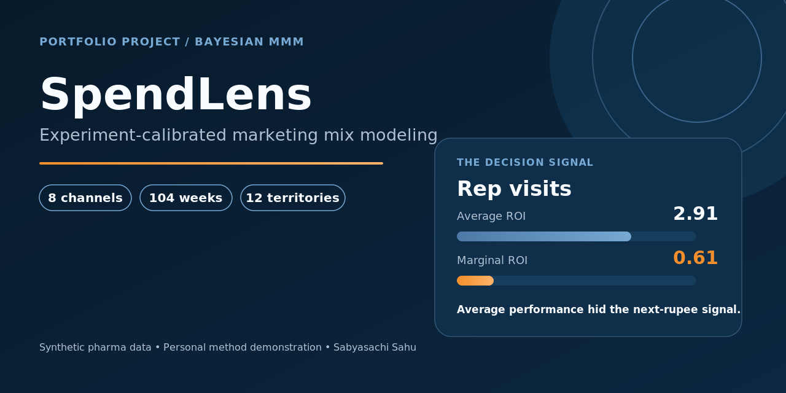
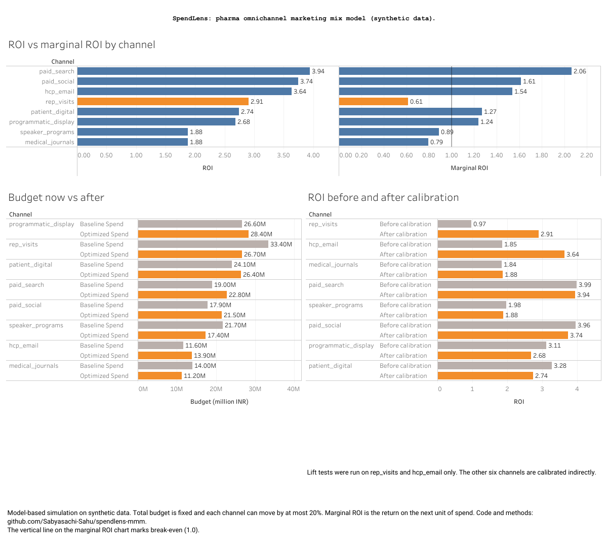
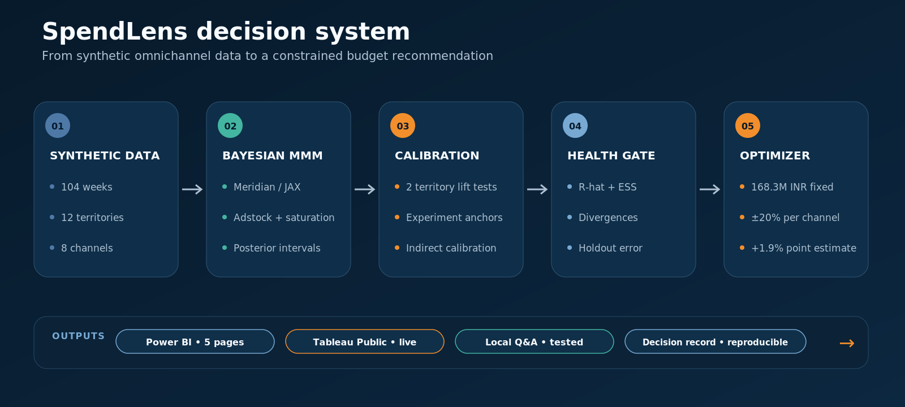

<p align="center">
  
</p>

# SpendLens

**An end-to-end Bayesian marketing mix modeling project for omnichannel pharma:** model health, experiment calibration, constrained budget optimization, and decision-facing dashboards.

> **Portfolio disclosure:** This is a personal method demonstration built on synthetic data. The simulated optimization result is a point estimate, not a forecast or a client outcome.

<p>
  <a href="https://public.tableau.com/app/profile/advance.analytics/viz/SpendLenspharmamarketingmixmodelsynthetic/SpendLensdashboard"><strong>Open the live Tableau dashboard →</strong></a>
</p>

## At a glance

| Scope | Result |
|---|---:|
| Modeling frame | 104 weeks · 12 territories · 8 channels |
| Simulated total spend | INR 168.3M |
| Paid-media ROI | 2.89 (90% interval: 2.27–3.59) |
| Holdout error after tuning | 3.4% |
| Experiment calibration | 2 territory-holdout lift tests |
| Budget rule | Total fixed; each channel constrained to ±20% |
| Simulated outcome change | +1.9% point estimate |

## The decision insight

The largest channel, **rep visits**, looked healthy on average: ROI **2.91**. Its **marginal ROI was 0.61**, below the 1.0 break-even line. Average performance described the historical mix; marginal performance changed the next-budget decision.

Under a fixed INR 168.3M budget and ±20% channel constraints, the optimizer moved spend toward paid search, paid social, and HCP email while reducing rep visits. This is a model-based scenario on synthetic data—not a claim of realized business impact.

<p align="center">
  
</p>

## Why calibration mattered

Two territory-holdout lift tests were used as experimental anchors:

| Channel | Before calibration | After calibration | Experiment result |
|---|---:|---:|---:|
| Rep visits | 0.97 | **2.91** | 3.16 |
| HCP email | 1.85 | **3.64** | 4.08 |

The remaining six channels were calibrated indirectly. This separates *what the observational model inferred* from *what experimental evidence supported*.

## Model health before model storytelling

The first specification was not accepted just because it ran. A health gate checked R-hat, effective sample size, divergences, and holdout error.

- A 12-knot time trend over-fit the data: **15.4% holdout error**.
- Six knots plus a tighter regional prior reduced holdout error to **3.4%**.
- Divergences fell from **7 to 1**.
- A **9-run tuning grid** retained the experiments tried, including the choices reversed.

## System map

<p align="center">
  
</p>

## What shipped

- **Bayesian MMM:** Google Meridian / JAX with adstock, saturation, posterior intervals, and holdout validation.
- **Experiment calibration:** two territory-holdout lift tests, with tested and indirectly calibrated channels distinguished.
- **Budget optimizer:** fixed total budget with a ±20% movement limit per channel.
- **Model health gate:** convergence, effective sample size, divergence, and predictive checks before results are published.
- **Dashboards:** a five-page Power BI project and a [verified public Tableau dashboard](https://public.tableau.com/app/profile/advance.analytics/viz/SpendLenspharmamarketingmixmodelsynthetic/SpendLensdashboard).
- **Local Q&A prototype:** an extractive Ollama-based interface, blind-tested and documented with its failures rather than presented as a reliable analyst.

## Q&A prototype: measured limits

The local prototype is intentionally described as an **extractive lookup over exported results**, not an autonomous analyst. In the first 10-question blind test it produced **2 clean answers, 1 correct refusal, 2 partial answers, and 5 failures**. The forecast guard and regression set are preserved so that capability claims remain testable.

Useful references already in the repository:

- [`src/spendlens/copilot.py`](src/spendlens/copilot.py)
- [`src/spendlens/copilot_facts.py`](src/spendlens/copilot_facts.py)
- [`scripts/eval_copilot.py`](scripts/eval_copilot.py)
- [`reports/copilot_eval.csv`](reports/copilot_eval.csv)
- [`reports/copilot_blind_test_1.txt`](reports/copilot_blind_test_1.txt)
- [`docs/copilot_blind_test_questions.txt`](docs/copilot_blind_test_questions.txt)

## Repository guide

```text
.
├── assets/                 # README banner, dashboard, system map, social card
├── data/                   # Synthetic inputs and model exports
├── docs/                   # Decision record and test documentation
├── powerbi/                # Power BI Project (PBIP / PBIR)
├── reports/                # Evaluation and blind-test outputs
├── scripts/                # Reproducible model and evaluation entry points
├── src/spendlens/          # Project and local Q&A modules
└── README.md
```

## Explore the result

1. Start with the [live Tableau dashboard](https://public.tableau.com/app/profile/advance.analytics/viz/SpendLenspharmamarketingmixmodelsynthetic/SpendLensdashboard).
2. Compare average ROI with marginal ROI—especially rep visits.
3. Review the calibration panel to separate experimental anchors from indirect calibration.
4. Read the decision record and tuning evidence before treating the optimized allocation as a recommendation.
5. Treat the +1.9% simulated outcome change as a point estimate under stated constraints, not a forecast.

## Stack

Python · Google Meridian · JAX · SQL · DuckDB · Power BI / DAX / PBIR · Tableau Public · Ollama · Git

## Responsible use

All data and scenarios in this project are synthetic. No patient, HCP, campaign, or client records are used. Results demonstrate a modeling and decision workflow; they do not represent commercial performance or medical guidance.

## Method notes

- **Paid-media share:** paid media drives 42.7% of outcomes (the rest is baseline).
- **How outcomes are valued:** the model explains a KPI. Each KPI unit is valued at an assumed 5,200 INR (a setting in the synthetic data, not a measured price), so ROI is incremental outcome value in INR per INR of spend.
- **Ground truth:** `data/ground_truth/simulation_truth.csv` holds the channel effects built into the synthetic data. It was not used for tuning, calibration or model selection (those used convergence, holdout error and the two lift tests).

## Limitations

- All data is synthetic. No real client or patient data is used.
- The +1.9% outcome lift from the budget move is a point estimate with no interval. Six of eight channels sit at the +/-20% limit, so the limit may matter more than the model.
- The 90% ranges for the top three channels (paid search, paid social, HCP email) overlap, so their order is not certain.
- Response curves are extrapolated beyond current spend.
- Only two channels (rep visits and HCP email) have lift tests. The other six are calibrated indirectly.
- The calibrated model passed the health gate narrowly (minimum effective sample size 401 against a limit of 400, divergence rate 0.075% against 0.1%).
- Power BI: the mROI column on the Budget Optimizer page is the marginal ROI at current spend, not after the reallocation.
- The Q&A copilot is an extractive prototype. It fails on multi-part and explanatory questions (see the blind test above).