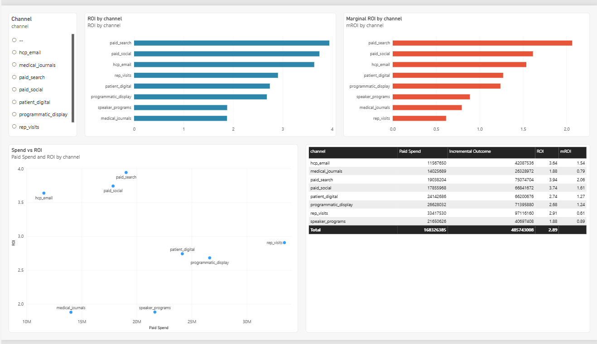
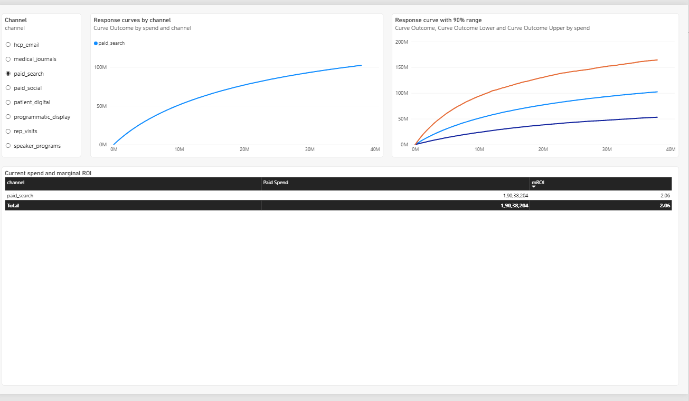
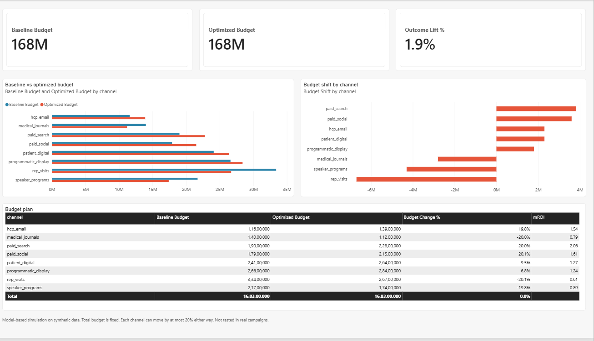
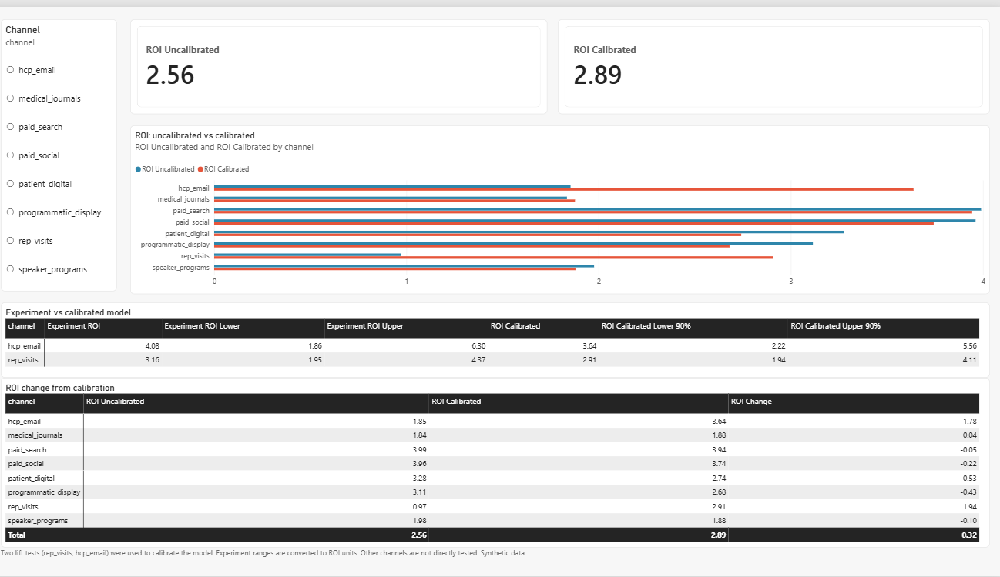

# SpendLens: Bayesian Marketing Mix Model for a pharma omnichannel brand

SpendLens estimates how much each marketing channel contributes to outcomes, calibrates the model with two lift tests, and recommends a budget reallocation. It is a portfolio project built on **synthetic data**. No real client or patient data is used.

## Headline results

| Item | Result |
|---|---|
| Paid media spend | 168.3M INR across 8 channels |
**How outcomes are valued:** the model explains a KPI. Each KPI unit is valued at an assumed 5,200 INR (a setting in the synthetic data, not a measured price), so ROI = incremental outcome value in INR per INR of spend.
| Total paid-media ROI (calibrated) | 2.89 (90% range 2.27 to 3.59) |
| Share of outcomes driven by paid media | 42.7% |
| Holdout error (last 13 weeks) | 3.4% MAPE |
| Optimised reallocation (same total budget, each channel within +/-20%) | +1.9% incremental outcome (point estimate, no interval) |

| Channel | ROI | Marginal ROI | Budget now | Budget after |
|---|---|---|---|---|
| paid_search | 3.94 | 2.06 | 19.0M | 22.8M |
| paid_social | 3.74 | 1.61 | 17.9M | 21.5M |
| hcp_email | 3.64 | 1.54 | 11.6M | 13.9M |
| patient_digital | 2.74 | 1.27 | 24.1M | 26.4M |
| programmatic_display | 2.68 | 1.24 | 26.6M | 28.4M |
| speaker_programs | 1.88 | 0.89 | 21.7M | 17.4M |
| medical_journals | 1.88 | 0.79 | 14.0M | 11.2M |
| rep_visits | 2.91 | 0.61 | 33.4M | 26.7M |

**Reading the table:** rep_visits is the largest channel and still pays back on average, but its marginal ROI is 0.61, so the next rupee returns less than it costs. That is the main finding: average ROI and marginal ROI point in different directions.

## What was built

- **Data:** 104 weeks x 12 territories, 8 channels (rep visits, speaker programs, HCP email, programmatic display, paid search, paid social, medical journals, patient digital), plus controls for competitor activity, market access, a launch pulse and flu season.
- **Ground truth:** `data/ground_truth/simulation_truth.csv` holds the channel effects built into the synthetic data. It was not used for tuning, calibration or model selection (those used convergence, holdout error and the two lift tests).
- **Model:** Google Meridian 2.1.0 (Bayesian MMM with carryover and diminishing returns), run on CPU in Windows.
- **Calibration:** ROI priors for rep_visits and hcp_email were built from two territory-holdout lift tests. The experiment ranges are converted to ROI units for comparison.
- **Budget optimiser:** fixed total budget, each paid channel limited to -20% / +20%.
- **Power BI dashboard:** five pages (Overview, Channel Performance, Response Curves, Budget Optimizer, Calibration).

## Power BI dashboard

Five pages read the exported CSV files. Pages 2 to 5 were built by an AI agent (Copilot CLI with Microsoft's powerbi-authoring plugin) and then checked by opening them in Power BI Desktop. The data model, measures and relationships were built by hand.

**Channel performance:** ROI and marginal ROI by channel, and spend against ROI.

**Response curves:** how outcome grows with spend. The right half of each curve is extrapolated beyond current spend. The range chart shows the mean with lower and upper 90% bounds for one selected channel.

**Budget optimizer:** the same total budget, with each channel limited to +/-20%.

**Calibration:** the model before and after using the two lift tests.

## Calibration check

| Channel | Experiment ROI (range) | Uncalibrated model | Calibrated model (90% range) |
|---|---|---|---|
| rep_visits | 3.16 (1.95 to 4.37) | 0.97 | 2.91 (1.94 to 4.11) |
| hcp_email | 4.08 (1.86 to 6.30) | 1.85 | 3.64 (2.22 to 5.56) |

Calibration moved both tested channels towards the experiments and moved credit away from the digital channels. Total ROI rose from 2.56 to 2.89.

## Model health gate

A model is only used for insight if it passes a written gate. Every run is recorded in a manifest (code commit, data hash, model hash).

| Check | Limit | Base model | Calibrated model |
|---|---|---|---|
| Max R-hat | <= 1.05 | 1.0105 | 1.0146 |
| Min effective sample size | >= 400 | 440 | 401 |
| Divergence rate | <= 0.1% | 0.025% | 0.075% |
| Holdout MAPE | <= 20% | 3.4% | 3.36% |

The calibrated model passed narrowly on ESS and divergences. I report it as a marginal pass.

## How it was tuned

- The first fit used 12 time knots and failed the gate (min ESS 67, holdout MAPE 15.4%). Six knots fixed the over-fit.
- Divergences came from the link between regional channel effects and their variance. A tighter prior on that variance (scale 0.3) cut divergences from 7 to 1. A scale of 0.2 was worse (5), so it was reverted.
- A 9-run grid over knots {4, 6, 8} and prior scale {0.25, 0.3, 0.4}, ranked on convergence first and holdout second, confirmed 6 knots and 0.3.
- No setting reached zero divergences, so the gate allows up to 0.1% of draws. The reasoning is written in `docs/decision_record.md`.

## Limitations

- All data is synthetic.
- The +1.9% lift is a point estimate. Six of eight channels sit at the +/-20% limit, so the limit may matter more than the model.
- The 90% ranges for the top three channels overlap, so their ranking is not certain.
- Response curves are extrapolated beyond current spend.
- Only two channels have experiments. The other six are calibrated indirectly.
- Power BI: the "mROI" column on the Budget Optimizer page is marginal ROI at current spend, not after reallocation.

## Reproduce

Python 3.11, Windows, PowerShell. Run from the project root with `PYTHONPATH=src` and `MERIDIAN_ENABLE_JAX_X64=False`.

    python -m scripts.generate_synthetic
    python -m spendlens.validate_data
    python -m scripts.build_portable_store
    python -m scripts.fit_meridian --mode full
    python -m scripts.diagnostics
    python -m scripts.prepare_calibration
    python -m scripts.fit_calibrated_model
    python -m scripts.diagnostics --model calibrated
    python -m scripts.compare_calibration
    python -m scripts.export_insights
    python -m scripts.optimize_budget

The Power BI project is in `powerbi/SpendLens.pbip` and reads the CSV files in `data/exports/`. Decisions and known issues are in `docs/decision_record.md`.

## Next

- GenAI insight copilot over the model outputs, with citations.
- A public Tableau dashboard.